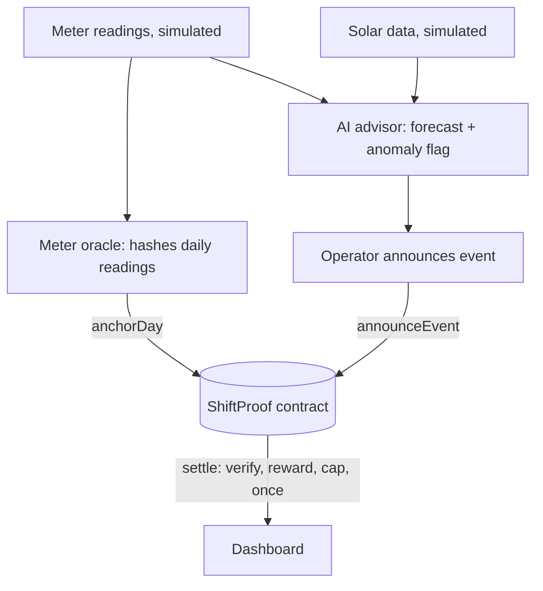

# ShiftProof: Verifiable Load-Shift Rewards

**Track:** Renewable Energy & Energy Trading · IEEE ClimateChain Global Hackathon

> AI recommends when to shift power use into solar hours. Fixed public rules and a smart contract decide the reward.

## Problem
Solar power peaks at midday, but flexible loads (pumps, EV charging) often run in the evening. Rewarding load shifting is easy to game: inflate the "normal" baseline, edit old records, claim savings the meter never recorded, claim twice, or shift load while using more energy overall.

## Solution
- **AI advisor (Python):** forecasts solar output and recommends the eligible solar hours. It advises only.
- **Fixed rules (not AI):** baseline = average of the same weekday's hourly use over the last 4 weeks.
- **Smart contract (Solidity):** the contract picks the 4 history days itself, checks every hash, recomputes the baseline, applies the cap, and settles once.

```
reward = max(0, min(drop, rise, cap) - rebound)
drop    = sum over non-eligible hours of max(0, baseline - actual)
rise    = sum over eligible hours of max(0, actual - baseline)
rebound = max(0, actualTotal - baselineTotal)
```

## Architecture


## Run it
```bash
npm install --legacy-peer-deps
npx hardhat test                 # 12 tests
pip install -r requirements.txt
npm run sim                      # simulated data + forecast + anomaly flag -> data/sim.json
npm run scenarios                # 8 scenarios on the real contract -> dashboard/results.json
```
Open `dashboard/index.html` in a browser (single file).

## Tests (12 passing)
Honest shift, reward cap, rebound, inflated baseline, edited history, duplicate settlement, late settlement, history anchored after announcement, cherry-picked days, unanchored event day, missing history day, access control.

## Simulation results (simulated data)
- Solar forecast: MAE 129.5 Wh, R² 0.984 (data generated by a formula, so the model learns that formula; this is a sanity check).
- History anomaly flag: 4 true positives, 1 false positive, 0 false negatives on anomalies we injected.

## Limitations
- The meter oracle is **trusted**; a hash proves data was not changed, not that it was honest.
- Data is **simulated**. No real meters or satellites.
- A 4-week average ignores weather and holidays; slow multi-week inflation is only partly handled.
- Demand-response measurement already exists. This project's contribution is public, recomputable, on-chain enforcement of the baseline rules.

## Next steps
Real smart-meter integration, multiple oracles, weather-adjusted baselines, Sepolia deployment, and a campus microgrid pilot.
