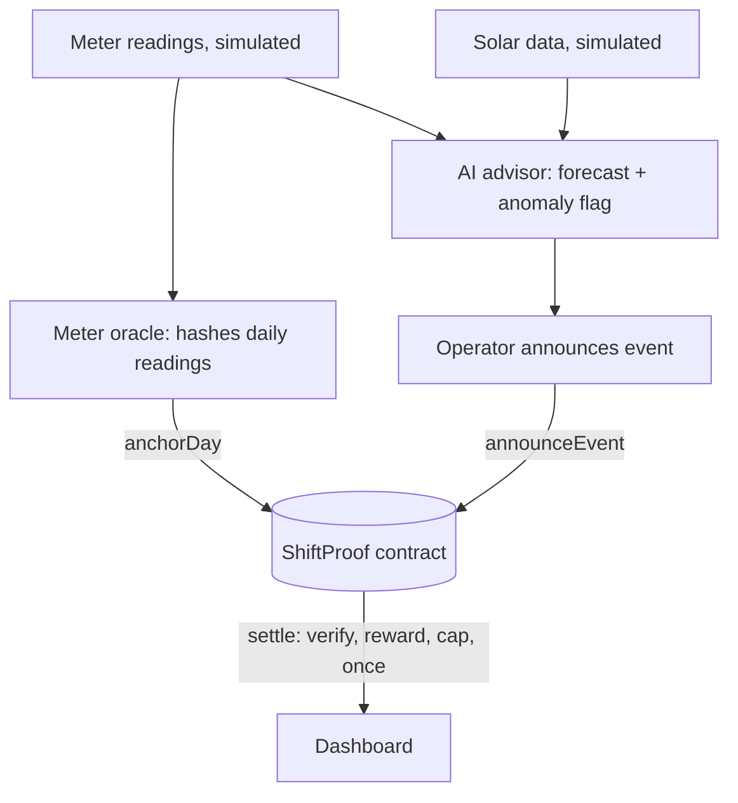

# ShiftProof: Verifiable Load-Shift Rewards

**Track:** Renewable Energy & Energy Trading · IEEE ClimateChain Global Hackathon

> AI recommends when to shift power use into solar hours. Fixed public rules and a smart contract decide the reward.

## Problem

Solar power peaks at midday, but flexible loads (pumps, EV charging) often run in the evening. Rewarding load shifting is easy to game: inflate the "normal" baseline, edit old records, claim savings the meter never recorded, claim twice, or shift load while using more energy overall.

## Solution

- **AI advisor (Python, simulated data):** forecasts solar output and recommends the eligible solar hours. It advises only.
- **Fixed rules (not AI):** baseline = average of the same weekday's hourly use over the last 4 weeks.
- **Smart contract (Solidity):** the contract picks the 4 history days itself, checks every hash, recomputes the baseline, applies the cap, and settles once. No real payment is made in this prototype.

```
reward = max(0, min(drop, rise, cap) - rebound)
drop    = sum over non-eligible hours of max(0, baseline - actual)
rise    = sum over eligible hours of max(0, actual - baseline)
rebound = max(0, actualTotal - baselineTotal)
```

## Architecture



---

## Prerequisites (Windows)

Install these before starting. Check the version commands to confirm they work.

| Tool | Download | Version check |
|------|----------|---------------|
| **Node.js** (LTS, 18+) | https://nodejs.org | `node --version` |
| **Python** (3.10+) | https://python.org/downloads | `python --version` |
| **Git** | https://git-scm.com | `git --version` |

> Open **Command Prompt** or **PowerShell** for all commands below.

---

## Step-by-step setup (Windows)

### 1. Install Node.js dependencies

```powershell
cd c:\path\to\shiftproof-repo
npm install --legacy-peer-deps
```

This downloads Hardhat, ethers.js, Chai, and the test helpers into `node_modules/`.  
Expected output: a progress bar, then `added N packages`.

### 2. Compile the smart contract

```powershell
npx hardhat compile
```

Expected output: `Compiled 1 Solidity file successfully` (or "Nothing to compile" if already done).

### 3. Run the Python simulation

```powershell
npm run sim
```

This runs `python sim/simulate.py` and writes `data/sim.json`.  
Expected output (example):
```
eligible hours: [11, 12, 13, 14] mask: 30720
forecast MAE (Wh): 129.5 R2: 0.984
anomaly TP/FP/FN: 4 1 0 precision 0.8 recall 1.0
baseline evening: [4251, 4215, 4228, 4223] actual evening: [2328, 2283, 2279, 2315]
```

> **Note:** All data is simulated. The model learns a formula we wrote, so the R² of 0.98 is a sanity check, not real-world accuracy.

### 4. Run the 8 contract scenarios

```powershell
npm run scenarios
```

This deploys `ShiftProof.sol` to a local in-memory test network, runs 8 scenarios (honest + attacks), and writes `dashboard/results.json`.  
Expected output: 8 lines like `1 Honest shift { status: 'rewarded', rewardWh: 7715 }` and `2 Inflated baseline { status: 'rejected', error: 'HashMismatch', args: [ '93' ] }`.

### 5. View the dashboard

The dashboard loads `results.json` at runtime, so it needs a local web server:

```powershell
# Option A: React + Vite dashboard
npm run dev
# Then open http://localhost:3000

# Option B: Direct static dashboard
python -m http.server 8000 --directory dashboard
# Then open http://localhost:8000
```

You will see 8 tabs — one per scenario — with an interactive 24-hour chart, 4 distinct metric summary cards, the smart contract's step-by-step verification checks, and mathematical reward calculation. Click any tab or press "Auto-play attacks" to cycle through.

> To stop the server press **Ctrl+C** in the terminal.

---

## Running the tests

```powershell
npx hardhat test
```

Expected output: **12 passing** (with a time in seconds). No failures.

```
ShiftProof
  ✔ 1. honest shift is rewarded (8,000 Wh)
  ✔ 2. reward is capped at the event cap
  ✔ 3. rebound (higher total use) reduces the reward
  ✔ 4. inflated baseline is rejected
  ✔ 5. altered history reading is rejected
  ✔ 6. duplicate settlement is rejected
  ✔ 7. late settlement (after deadline) is rejected
  ✔ 8. history anchored AFTER the event announcement is rejected
  ✔ 9. cherry-picked (decoy) history days are rejected
  ✔ 10. unanchored event-day readings are rejected
  ✔ 11. missing history day is rejected
  ✔ 12. access control and double anchoring

12 passing (Xs)
```

---

## What each `npm run` command does

| Command | What it runs | Output |
|---------|-------------|--------|
| `npm run sim` | `python sim/simulate.py` | `data/sim.json` |
| `npm run scenarios` | `npx hardhat run scripts/run_scenarios.js` | `dashboard/results.json` |
| `npm test` | `npx hardhat test` | Test results in terminal |
| `npm run compile` | `npx hardhat compile` | Compiled contract in `artifacts/` |

---

## Simulation results (simulated data only)

- Solar forecast: MAE 129.5 Wh, R² 0.984 (data generated by a formula, so the model learns that formula; this is a sanity check, not a real-world accuracy claim).
- History anomaly flag: 4 true positives, 1 false positive, 0 false negatives on anomalies **we injected ourselves** — this is a sanity check, not a real-world test.

---

## Limitations

- The meter oracle is **trusted**; a hash proves data was not changed after anchoring, not that it was honest when submitted.
- All data is **simulated**. No real meters, no real solar panels, no real transactions.
- A 4-week average ignores weather and holidays; slow multi-week inflation is only partly handled.
- **No real payments are made.** The contract records a reward number only. This is a prototype.
- Demand-response measurement already exists. This project's contribution is public, recomputable, on-chain enforcement of the baseline rules.

## Next steps

Real smart-meter integration, multiple oracles, weather-adjusted baselines, Sepolia testnet deployment (with play-money ETH), and a campus microgrid pilot.
